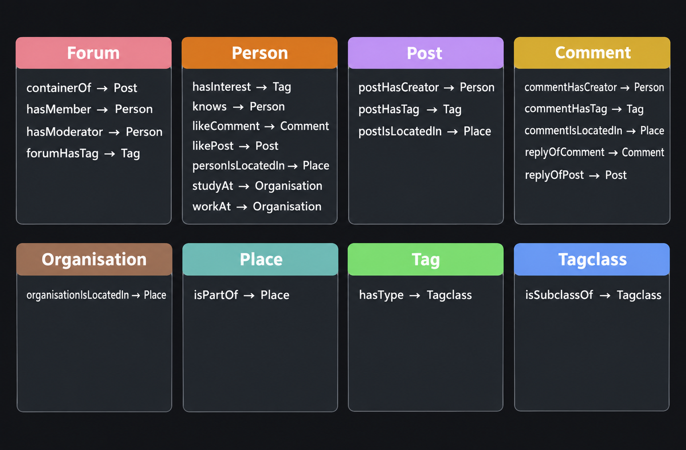

# Graph benchmarks: LDBC SNB SF1 Interactive complex queries

This repository hosts 14 complex read queries (IC1–IC14) adapted from the [LDBC Social Network Benchmark (SNB) Interactive v1 workload](https://github.com/ldbc/ldbc_snb_interactive_v1_impls), using the scale factor 1 (SF1) dataset.

It is maintained by [HDC Labs](https://hyperdimensionalcomputing.ai/) and complements [graph-benchmark-ldbc](https://github.com/hyperdimensionalcomputingai/graph-benchmark-ldbc), which contains a separate, custom 30-query workload. This is **not** an official LDBC benchmark and is not endorsed by GDC/LDBC in any way.

<details>
<summary>Licensing, provenance and benchmark status</summary>

The project adopts [Apache License 2.0](LICENSE) for this derivative and future contributions. Inherited MIT-covered software retains its original grant and [MIT copyright and permission notice](LICENSES/MIT.txt). Package metadata uses `Apache-2.0 AND MIT`; preserve both licences when redistributing the combined software. This does not assign earlier contributors' copyright or imply new Apache patent grants from them.

We credit the Linked Data Benchmark Council (LDBC), now the Graph Data Council (GDC), for the SNB dataset, data model and query definitions. The adapted official Cypher implementations are Apache-2.0 licensed; their [original licence](LICENSES/LDBC-Apache-2.0.txt) and [notice](NOTICE.txt) are retained. Dataset, data-model and image rights remain separate from the software licence. See [third-party provenance and review gaps](THIRD_PARTY_NOTICES.md) and [contribution guidance](CONTRIBUTING.md).

**These are not LDBC Benchmark Results.** This project is unaudited and is not approved or endorsed by LDBC/GDC. It uses adapted queries, one fixed parameter set per query and `pytest-benchmark`, rather than the official driver's workload mix and generated parameters. See the [Fair Use Policy](https://ldbcouncil.org/benchmarks/fair-use-policies/).

</details>

## Setup

Use Python 3.13 or newer and [uv](https://docs.astral.sh/uv/getting-started/installation/):

```sh
uv sync --locked
```

This installs the engine dependencies; no project package needs to be built or installed. Dependencies and resolved versions are recorded in `pyproject.toml` and `uv.lock`.

## Dataset

The downloader uses the SNB Interactive v1 initial SF1 dataset (`CsvBasic`, `StringDateFormatter`) from the [official dataset collection](https://ldbcouncil.org/benchmarks/snb/datasets/). Install `curl`, `tar` and either `zstd` or `unzstd` before downloading:

```sh
uv run download_dataset.py
```

The script extracts data to ignored `csv/` and skips downloading when that directory already exists. It prints a SHA-256 hash but does not check it against an upstream expected digest.

## Ingest the data as a graph



Each engine directory contains its ingestion script, queries and benchmark harness:

| Engine | Instructions | Execution model |
| --- | --- | --- |
| Neo4j | [Setup and ingestion](neo4j/README.md) | Server, with Docker configuration included |
| Kuzu | [Setup and ingestion](kuzu/README.md) | Embedded |
| Ladybug | [Setup and ingestion](ladybugdb/README.md) | Embedded |

The schema uses separate relationship types such as `postHasCreator` and `commentHasCreator`, and `Place` and `Organisation` nodes with a `type` property. Configure Neo4j using `neo4j/.env.example`; local credentials and database files are ignored by Git.

## Queries and correctness

### Example: Q14 — trusted connection paths

Given two people, Q14 (IC14) finds **every shortest friendship path** between them, then ranks those paths by how much neighbouring people have interacted. In this suite, the endpoints are person `1131` and person `19791209300775`.

The Neo4j query starts by finding paths through `knows` relationships in either direction:

```cypher
MATCH path = allShortestPaths(
    (person1:Person {ID: $person1Id})-[:knows*0..]-(person2:Person {ID: $person2Id})
)
```

For each adjacent pair of people along each path, it counts replies in both directions:

| Interaction between the pair | Contribution to path weight |
| --- | ---: |
| A comment replying to the other person's post | 1.0 |
| A comment replying to the other person's comment | 0.5 |

It sums these contributions across the path and returns the ordered person IDs and total weight, highest weight first. “Shortest” means fewest friendship hops; interaction weights rank those shortest paths afterwards.

This combines variable-length traversal, enumeration of all shortest paths, additional traversals through comments and posts for every friendship step, aggregation and sorting. See `run_query14` in the [Neo4j implementation](neo4j/query.py) for the complete query.

### Query adaptations and checks

Each engine's `query.py` implements IC1–IC14. The module docstrings describe the adaptations from the official Cypher:

- `Message` becomes Post/Comment label or relationship alternatives.
- City/Country and University/Company become Place and Organisation.
- IC1 omits person emails and languages, which ingestion does not load, and uses an explicit null check for missing universities.
- Kuzu and Ladybug use their shortest-path syntax and `EXISTS` subqueries where required.

Each engine exposes `run_query1` through `run_query14`, with fixed parameters beside the query text. Its benchmark harness calls each query directly and checks the result after timing. Shared golden-answer checks live in [`conftest.py`](conftest.py). Most queries start from person 1131; IC13 and IC14 use person 1131 and person 19791209300775. These are a single fixture, not a representative parameter workload.

[`expected/`](expected/) contains 14 golden-answer JSON files originally generated using Neo4j. Comparisons normalize timestamps and unordered collected values; IC14 rows are compared without row-order dependence. `WRITE_GOLDEN=1` overwrites these fixtures and should only be used when deliberately regenerating them. Agreement with these fixtures is not independent verification of the LDBC specification.

## Benchmark settings

Follow the engine setup instructions, then run the benchmark from that engine directory:

```sh
uv run pytest benchmark_query.py --benchmark-min-rounds=5 --benchmark-disable-gc
```

The optional `./run_benchmarks.sh` runs all three engines and overwrites their named output files in `results/`.

The runner uses at least five measured rounds per query, `time.perf_counter`, disabled garbage collection and warmup off. Query result conversion happens within the timed call; golden-answer comparison happens afterwards. The default query timeout is 10 seconds, configurable through `QUERY_TIMEOUT_SECONDS`. Server and embedded deployments have different resource boundaries, so a future comparison needs a documented machine and database configuration.

## Results

[`results/`](results/) contains saved benchmark output, and [`results/compare.py`](results/compare.py) prints a comparison table. Results apply to the engine versions and deployment configurations recorded with each run. Before comparing systems, use a documented machine, database configuration and benchmark protocol.
