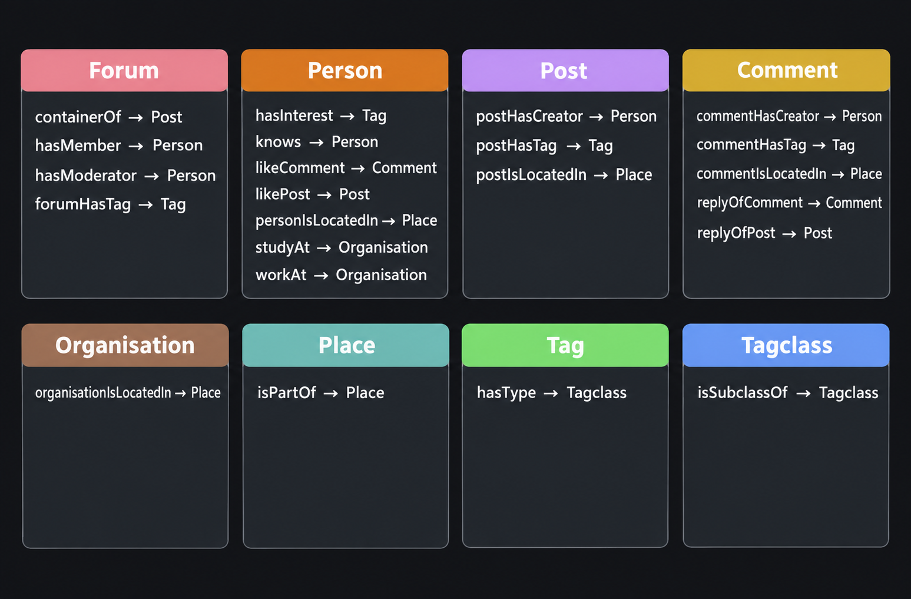

# Graph benchmarks: LDBC SNB SF1 Interactive complex queries

This repository hosts 14 complex read queries (IC1–IC14) adapted from the [LDBC Social Network Benchmark (SNB) Interactive v1 workload](https://github.com/ldbc/ldbc_snb_interactive_v1_impls), using the scale factor 1 (SF1) dataset.

It is maintained by [HDC Labs](https://hyperdimensionalcomputing.ai/) and complements [graph-benchmark-ldbc](https://github.com/hyperdimensionalcomputingai/graph-benchmark-ldbc), which contains a separate, custom 30-query workload. This is **not** an official LDBC benchmark and is not endorsed by GDC/LDBC in any way.

<details>
<summary>Licensing, provenance and benchmark status</summary>

The project adopts [Apache License 2.0](LICENSE) for this derivative and future contributions. Inherited MIT-covered software retains its original grant and [MIT copyright and permission notice](LICENSES/MIT.txt). Package metadata uses `Apache-2.0 AND MIT`; preserve both licences when redistributing the combined software. This does not assign earlier contributors' copyright or imply new Apache patent grants from them.

We credit the Linked Data Benchmark Council (LDBC), now the Graph Data Council (GDC), for the SNB dataset, data model and query definitions. The adapted official Cypher implementations are Apache-2.0 licensed; their [original licence](LICENSES/LDBC-Apache-2.0.txt) and [notice](NOTICE.txt) are retained. Dataset, data-model and image rights remain separate from the software licence. See [third-party provenance and review gaps](THIRD_PARTY_NOTICES.md) and [contribution guidance](CONTRIBUTING.md).

**These are not LDBC Benchmark Results.** This project is unaudited and is not approved or endorsed by LDBC/GDC. It uses adapted queries, one fixed parameter set per query and `pytest-benchmark`, rather than the official driver's workload mix and generated parameters. See the [Fair Use Policy](https://ldbcouncil.org/benchmarks/fair-use-policies/).

</details>

## Setup

Use Python 3.13 or newer and [uv](https://docs.astral.sh/uv/getting-started/installation/):

```sh
uv sync --locked
```

This installs the engine dependencies; no project package needs to be built or installed. Dependencies and resolved versions are recorded in `pyproject.toml` and `uv.lock`.

## Dataset

The downloader uses the SNB Interactive v1 initial SF1 dataset (`CsvBasic`, `StringDateFormatter`) from the [official dataset collection](https://ldbcouncil.org/benchmarks/snb/datasets/). Install `curl`, `tar` and either `zstd` or `unzstd` before downloading:

```sh
uv run download_dataset.py
```

The script extracts data to ignored `csv/` and skips downloading when that directory already exists. It prints a SHA-256 hash but does not check it against an upstream expected digest.

## Ingest the data as a graph



Each engine directory contains its ingestion script, queries and benchmark harness:

| Engine | Instructions | Execution model |
| --- | --- | --- |
| Neo4j | [Setup and ingestion](neo4j/README.md) | Server, with Docker configuration included |
| Kuzu | [Setup and ingestion](kuzu/README.md) | Embedded |
| Ladybug | [Setup and ingestion](ladybugdb/README.md) | Embedded |
| lance-csr | [Setup and ingestion](lance_csr/README.md) | Embedded, over Lance datasets |

The schema uses separate relationship types such as `postHasCreator` and `commentHasCreator`, and `Place` and `Organisation` nodes with a `type` property. Configure Neo4j using `neo4j/.env.example`; local credentials and database files are ignored by Git.

## Queries and correctness

These queries are complex on several counts: they traverse multiple hops, join different node and relationship types, preserve partial results through optional matches, aggregate nested results, and rank the final output. The examples below show how those operations combine in a single query.

### Example: Q1 — friends, universities and employers

Q1 (IC1) finds people named `Jose` within three friendship hops of person `1131`, selects the nearest 20, and enriches their profiles with their city, universities and employers. Here is the full query from the [Neo4j implementation](neo4j/query.py):

```cypher
MATCH (p:Person {ID: $personId}), (friend:Person {firstName: $firstName})
WHERE NOT p = friend
WITH p, friend
MATCH path = shortestPath((p)-[:knows*1..3]-(friend))
WITH min(length(path)) AS distance, friend
ORDER BY distance ASC, friend.lastName ASC, friend.ID ASC
LIMIT 20

MATCH (friend)-[:personIsLocatedIn]->(friendCity:Place)
OPTIONAL MATCH (friend)-[studyAt:studyAt]->(uni:Organisation)-[:organisationIsLocatedIn]->(uniCity:Place)
WITH friend, collect(
    CASE WHEN uni IS NULL THEN null
        ELSE [uni.name, studyAt.classYear, uniCity.name]
    END) AS unis, friendCity, distance

OPTIONAL MATCH (friend)-[workAt:workAt]->(company:Organisation)-[:organisationIsLocatedIn]->(companyCountry:Place)
WITH friend, collect(
    CASE WHEN company IS NULL THEN null
        ELSE [company.name, workAt.workFrom, companyCountry.name]
    END) AS companies, unis, friendCity, distance

RETURN
    friend.ID AS friendId,
    friend.lastName AS friendLastName,
    distance AS distanceFromPerson,
    friend.birthday AS friendBirthday,
    friend.creationDate AS friendCreationDate,
    friend.gender AS friendGender,
    friend.browserUsed AS friendBrowserUsed,
    friend.locationIP AS friendLocationIp,
    friendCity.name AS friendCityName,
    unis AS friendUniversities,
    companies AS friendCompanies
ORDER BY distanceFromPerson ASC, friendLastName ASC, friendId ASC
LIMIT 20
```

The two `OPTIONAL MATCH` clauses keep a person in the result even when they have no matching university or employer. Each education or employment match also traverses to the organization's location. The intervening `WITH` and `collect()` clauses group education records before expanding employment records, avoiding a cross-product of the two lists. Null handling produces empty lists for missing records, while the final sort restores the requested distance, name and ID order.

This query combines bounded shortest-path search, filtering, a top-20 selection, optional multi-hop joins, nested-list aggregation and final ordering.

### Example: Q14 — trusted connection paths

Given two people, Q14 (IC14) finds **every shortest friendship path** between them, then ranks those paths by how much neighbouring people have interacted. In this suite, the endpoints are person `1131` and person `19791209300775`.

The Neo4j query starts by finding paths through `knows` relationships in either direction:

```cypher
MATCH path = allShortestPaths(
    (person1:Person {ID: $person1Id})-[:knows*0..]-(person2:Person {ID: $person2Id})
)
```

For each adjacent pair of people along each path, it counts replies in both directions:

| Interaction between the pair | Contribution to path weight |
| --- | ---: |
| A comment replying to the other person's post | 1.0 |
| A comment replying to the other person's comment | 0.5 |

It sums these contributions across the path and returns the ordered person IDs and total weight, highest weight first. “Shortest” means fewest friendship hops; interaction weights rank those shortest paths afterwards.

This combines variable-length traversal, enumeration of all shortest paths, additional traversals through comments and posts for every friendship step, aggregation and sorting. See `run_query14` in the [Neo4j implementation](neo4j/query.py) for the complete query.

### Query adaptations and checks

Each engine's `query.py` implements IC1–IC14. The module docstrings describe the adaptations from the official Cypher:

- `Message` becomes Post/Comment label or relationship alternatives.
- City/Country and University/Company become Place and Organisation.
- IC1 omits person emails and languages, which ingestion does not load, and uses an explicit null check for missing universities.
- Kuzu and Ladybug use their shortest-path syntax and `EXISTS` subqueries where required.
- lance-csr runs Neo4j's text unchanged for all 14 queries. A faster IC14 written without `reduce()` is in the [lance-csr README](lance_csr/README.md#alternative-ic14-syntax), but it isn't used in the saved results.

Each engine exposes `run_query1` through `run_query14`, with fixed parameters beside the query text. Its benchmark harness calls each query directly and checks the result after timing. Shared golden-answer checks live in [`conftest.py`](conftest.py). Most queries start from person 1131; IC13 and IC14 use person 1131 and person 19791209300775. These are a single fixture, not a representative parameter workload.

[`expected/`](expected/) contains 14 golden-answer JSON files originally generated using Neo4j. Comparisons normalize timestamps and unordered collected values; IC14 rows are compared without row-order dependence. `WRITE_GOLDEN=1` overwrites these fixtures and should only be used when deliberately regenerating them. Agreement with these fixtures is not independent verification of the LDBC specification.

## Benchmark settings

Follow the engine setup instructions, then run the benchmark from that engine directory:

```sh
uv run pytest benchmark_query.py --benchmark-min-rounds=5 --benchmark-disable-gc
```

The optional `./run_benchmarks.sh` runs every engine (lance-csr with its data in memory and read lazily) and overwrites their named output files in `results/`.

The runner uses at least five measured rounds per query, `time.perf_counter`, disabled garbage collection and warmup off. Query result conversion happens within the timed call; golden-answer comparison happens afterwards. The default query timeout is 10 seconds, configurable through `QUERY_TIMEOUT_SECONDS`. Server and embedded deployments have different resource boundaries, so a future comparison needs a documented machine and database configuration.

## Results

[`results/`](results/) contains saved benchmark output, and [`results/compare.py`](results/compare.py) prints a comparison table; output from older engine versions is kept in [`results/archived/`](results/archived/). Results apply to the engine versions and deployment configurations recorded with each run. Before comparing systems, use a documented machine, database configuration and benchmark protocol.

The saved runs below used an Apple M5 with 24 GB RAM and macOS 26.6.2. Neo4j and Kuzu ran on 2026-10-24; Ladybug 0.22.1 ran on 2026-11-01 (2026-11-02 UTC) as a repeat run after the machine was quiet. lance-csr 0.9.1 was run on its own with `./run_benchmarks.sh lance_csr` on 2026-11-10, as recorded by the runner in [`results/environment.yml`](results/environment.yml), on AC power, using the existing `graph_lance/` datasets. Other engines were not re-run for this upgrade.

The table gives mean latencies in milliseconds. Each number in brackets is Neo4j's latency divided by that engine's (higher is faster than Neo4j); `n/a` marks a wrong answer or error. These are separate runs with one fixed parameter set per query, not a controlled same-session comparison of versions.

| Query | neo4j-2026.09.0 (ms) | kuzu-0.11.3 (ms) | ladybug-0.22.1 (ms) | lance-csr-0.9.1-lazy (ms) | lance-csr-0.9.1-memory (ms) |
| --- | ---: | ---: | ---: | ---: | ---: |
| IC1 | 51.4 | 13.5 (3.80x) | 36.8 (1.40x) | 32.9 (1.56x) | 23.4 (2.19x) |
| IC2 | 44.7 | 25.0 (1.79x) | 6.1 (7.34x) | 26.0 (1.72x) | 2.8 (16.07x) |
| IC3 | 894.9 | 105.2 (8.51x) | 116.3 (7.69x) | 172.7 (5.18x) | 26.5 (33.77x) |
| IC4 | 13.1 | 29.7 (0.44x) | 5.6 (2.34x) | 13.3 (0.98x) | 5.9 (2.20x) |
| IC5 | 1022.6 | 747.7 (1.37x) | 263.0 (3.89x) | 103.8 (9.85x) | 82.7 (12.36x) |
| IC6 | 231.2 | 1114.8 (0.21x) | 9.6 (23.97x) | 25.4 (9.10x) | 22.2 (10.42x) |
| IC7 | 7.1 | 453.7 (0.02x) | 304.7 (0.02x) | 14.1 (0.51x) | 9.6 (0.75x) |
| IC8 | 3.0 | 73.4 (0.04x) | 0.9 (3.44x) | 3.4 (0.89x) | 2.3 (1.33x) |
| IC9 | 802.3 | 131.0 (6.13x) | 57.1 (14.05x) | 324.4 (2.47x) | 41.9 (19.14x) |
| IC10 | 91.7 | 74.9 (1.22x) | 11.5 (7.94x) | 29.8 (3.08x) | 21.0 (4.37x) |
| IC11 | 11.0 | 4.7 (2.34x) | 1.7 (6.53x) | 5.6 (1.96x) | 3.0 (3.66x) |
| IC12 | 133.9 | 92.3 (1.45x) | 22.8 (5.88x) | 23.7 (5.66x) | 21.7 (6.16x) |
| IC13 | 0.9 | 14.2 (0.06x) | 48.5 (0.02x) | 1.4 (0.64x) | 1.1 (0.86x) |
| IC14 | 522.6 | 1871.2 (0.28x) | 88.0 (5.94x) | 312.9 (1.67x) | 302.0 (1.73x) |

Every engine returned the golden answer for all 14 queries. lance-csr with its data in memory had the lowest mean on five queries (IC2, IC3, IC5, IC9, IC12) and Ladybug on six (IC4, IC6, IC8, IC10, IC11, IC14); Neo4j was fastest on IC7 and IC13, and Kuzu on IC1. Reading lance-csr's datasets lazily from disk was 6–10x slower than the in-memory mode on IC2, IC3 and IC9, and up to about 2x slower elsewhere. lance-csr now runs Neo4j's official IC14 text, which takes about 300 ms; an equivalent rewrite without `reduce()`, documented in the [lance-csr README](lance_csr/README.md#alternative-ic14-syntax), took about 51 ms but isn't used here. These observations apply only to this fixture and benchmark configuration.
